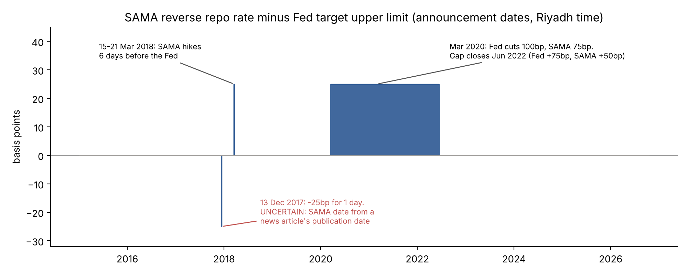
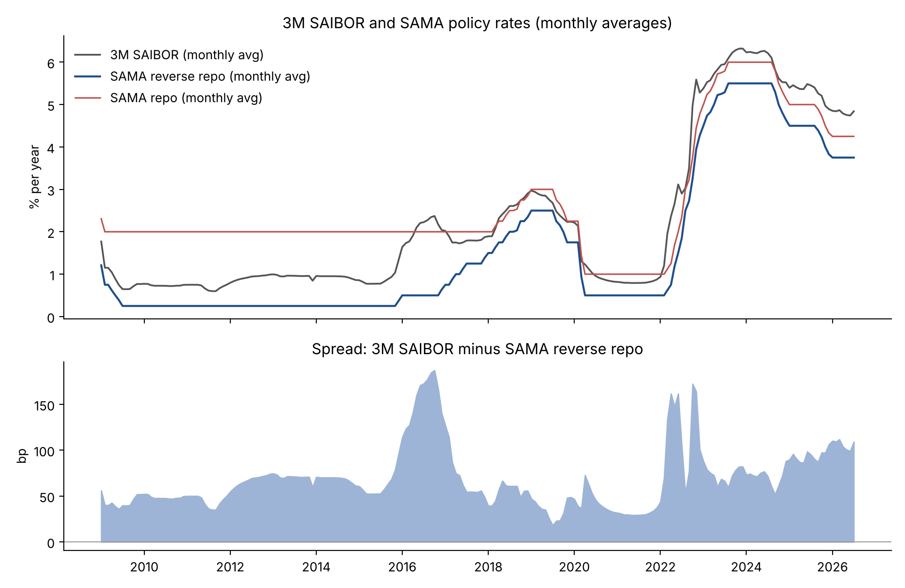
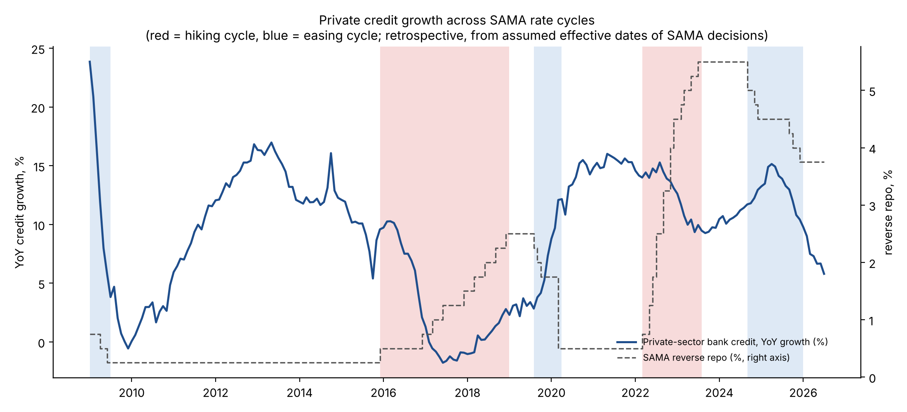

# From US Rates to Saudi Credit

**How US interest-rate changes pass through to Saudi policy rates, interbank rates and private-sector credit (2009–2026)**

*Exploratory research project by Osama Almutairi (MSc Finance, University of Exeter). Version 1, October 2026.*

---

## Research question

The Saudi riyal has been pegged to the US dollar at SAR 3.75/$ since 1986 ([Alkhareif & Qualls, SAMA Working Paper WP/16/4, 2016](https://www.sama.gov.sa/en-US/EconomicResearch/WorkingPapers/Saudi%20Arabia%E2%80%99s%20Exchange%20Rate%20Policy%20Its%20Impact%20on%20Historical%20Economic%20Performance.pdf)), and the Saudi Central Bank (SAMA) largely follows the US Federal Reserve. This project asks how Fed rate changes pass through to:

1. **SAMA's policy rates** (repo and reverse repo): how closely and how quickly they follow the Fed, and when they differ.
2. **3-month SAIBOR**, the interbank rate that links policy to borrowing costs.
3. **Private-sector bank credit**: how lending growth behaved across rate cycles.

**V1 scope:** macro-level, historical and descriptive-to-exploratory. It does not estimate causal effects, forecast, or analyse individual banks. Bank case studies are planned for V2 (see [Roadmap](#roadmap)).

---

## Key findings (exploratory)

**1. SAMA tracks the Fed closely at the decision level.**
Each of the 32 Fed rate changes since 2009 has a SAMA reverse-repo move within a ±7-day window. 30 of the 32 are the same size, and 30 were recorded on the same day (Riyadh dates). The exceptions are informative:

- **15 Mar 2018:** SAMA raised rates **six days before** the Fed. It was also SAMA's first repo-rate change since 2009.
- **Mar 2020:** the Fed cut by 100bp and SAMA by 75bp. That left SAMA's reverse repo 25bp above the Fed's upper limit until **Jun 2022**, when SAMA raised by 50bp against the Fed's 75bp.
- **Dec 2017:** SAMA's decision date comes from a news article's publication date and is treated as uncertain.



**2. SAIBOR moves closely with policy rates.**
Across the specifications examined, the estimated cumulative association between policy-rate changes and 3M SAIBOR changes is **about 0.76–0.81**. That means a 1pp policy change is associated with roughly a 0.8pp SAIBOR change. The same-month association is strong, but monthly averages cannot establish when the adjustment happened, and the lag pattern changes between models. Whether this is statistically different from one-for-one depends on the covariance specification: the 95% interval includes 1 at Newey-West bandwidths 4 and 6, but not at 12. Interpretation is also limited by residual autocorrelation and possible instability over time. The point estimate is higher from 2020 onwards, but the difference from the earlier period is not statistically significant (p = 0.42 in the baseline model).



**3. Credit grew more slowly during hiking cycles, but the rate link is imprecise.**
Average year-on-year credit growth was **5.8% in hiking cycles** (54 months), compared with 11.6% in easing cycles (30 months) and 10.2% between cycles (127 months). However, the 2015–18 hiking cycle overlaps the oil-price collapse and fiscal tightening, so these averages do not isolate the effect of rates. In a fixed-specification model of monthly credit growth, a 1pp higher reverse repo, held there thereafter and compared with an unchanged-rate path, is associated with an approximately **1.1–1.3% lower credit stock after 6–12 months**. These estimates are imprecise. Of the three horizons examined (3, 6 and 12 months), only the 6-month result is close to significance, and it is borderline: p = 0.04 in the main specification, rising to about 0.06 under the alternative timing convention and bandwidths (range 0.039–0.064). The 3- and 12-month intervals include zero.



> All results are **associations, not causal effects**. See [Limitations](#limitations).

---

## Data

All series were downloaded on **19 October 2026** from official sources.

| Series | Source | Frequency | Coverage |
|---|---|---|---|
| Fed funds target range (upper, lower) | FRED: [DFEDTARU](https://fred.stlouisfed.org/series/DFEDTARU), [DFEDTARL](https://fred.stlouisfed.org/series/DFEDTARL) | Daily | Dec 2008 – Oct 2026 |
| SAMA repo and reverse repo rates, 3M SAIBOR (monthly average), SAR–USD deposit rate spreads | [SAMA Statistical Report: Monetary Indicators (Interest Rates)](https://www.sama.gov.sa/en-US/Publications/EconomicReports/Pages/report.aspx?cid=118) | Monthly | Jan 2007 – Aug 2026 |
| Bank claims on the private sector (bank credit, securities) | [SAMA Monetary and Financial Statistics](https://sama.gov.sa/en-US/Publications/EconomicReports/Pages/report.aspx?cid=55) | Monthly | Jan 1993 – Aug 2026 |
| Real estate loans by banks (optional extension) | SAMA Monetary and Financial Statistics | Quarterly | Q1 2009 – Q2 2026 |
| Brent crude (main oil control), Dubai crude (robustness check) | FRED / IMF: [POILBREUSDM](https://fred.stlouisfed.org/series/POILBREUSDM), [POILDUBUSDM](https://fred.stlouisfed.org/series/POILDUBUSDM) | Monthly average | Jan 1992 – Jul 2026 |
| SAMA and Fed rate decision dates | SAMA press releases, Federal Reserve, Argaam and other press (each row has its source) | Event | 2009 – Sep 2026 |

**Samples:**
- Monthly panel: Jan 2009 – Jul 2026, **211 months** (no missing months in any core series).
- SAIBOR regressions (notebook 03): May 2009 – Jul 2026, **207 months** (lost to differencing and lags).
- Credit regressions (notebook 04): Feb 2010 – Jul 2026, **198 months** (12 policy lags).
- Decision-level analysis (notebook 02): Jan 2009 – Sep 2026, including the 16 Sep 2026 decisions.

**Download notes:**
- Use SAMA's **Export (Excel)** button with *All available dates* and *Monthly*. The PDF export only contains the last few years.
- The Excel export is not a true Excel file. It is HTML packaged as MIME, with Annual, Quarterly and Monthly sheets. `01_data_preparation.py` parses it using only the Python standard library and identifies each file by its content, not its filename.

A full variable list, with units, sources and treatment, is in [`data/processed/data_dictionary.md`](data/processed/data_dictionary.md).

---

## How to run

**Requirements:** Python 3 with `pandas`, `numpy` and `matplotlib`. Statistical tests are written out in numpy, so `statsmodels` is not needed. During development they were cross-checked against statsmodels.

1. Place the raw downloads in `data/raw/`. Keep the FRED names (`DFEDTARU.csv`, `DFEDTARL.csv`, `POILBREUSDM.csv`, `POILDUBUSDM.csv`). SAMA files can keep any name starting with `SAMA`.
2. Run the scripts **in order** (in Spyder: open each file and press F5, or step through the `# %%` cells with Shift + Enter):

| Script | Objective | Main outputs |
|---|---|---|
| `notebooks/01_data_preparation.py` | Load, clean, align to monthly, check coverage and data quality | `monthly_panel.csv`, `coverage_table.csv`, `data_dictionary.md` |
| `notebooks/02_policy_alignment.py` | Fed vs SAMA decision-level and monthly alignment | `policy_decisions.csv`, `sama_policy_monthly_avg.csv` |
| `notebooks/03_saibor_passthrough.py` | Policy rate to 3M SAIBOR pass-through | `passthrough_*.csv` |
| `notebooks/04_credit_growth.py` | Credit growth across rate cycles | `credit_*.csv` |

The scripts expect the project folder at `~/saudi-rate-passthrough`. To use another location, change `PROJECT` at the top of each script. Nothing in `data/raw/` is modified.

```
saudi-rate-passthrough/
├── data/
│   ├── raw/          # original downloads, untouched
│   └── processed/    # outputs of the scripts
├── notebooks/        # 01–04 analysis scripts
├── charts/           # all figures
└── README.md
```

---

## Methods

**Notebook 01: data preparation**
- The Fed target range is converted from daily to two monthly measures: the month-end midpoint (used in charts) and the monthly-average midpoint (an additional prepared measure, comparable with monthly-average SAIBOR; the V1 regressions use SAMA policy-rate changes, not this series).
- The main credit measure is **private-sector bank credit**, not total claims (which include holdings of securities).
- Quality checks: loans plus bills discounted equal total bank credit in every month, and bank credit plus securities equals the grand total.

**Notebook 02: policy alignment**
- A hand-collected table of 35 SAMA decisions, each with its source (21 read from the source page, 14 dated from the URL or listing).
- SAMA's daily policy rates are rebuilt from this table. The rebuilt month-end levels match SAMA's published month-end rates in all 211 months. This confirms levels and months, not exact days.
- **Timing convention:** decisions are treated as effective the day after announcement. This is the only convention with zero month-end mismatches, but it is directly supported only by the Jul 2019 boundary case, so it remains a provisional convention. All dates are Riyadh local time.

**Notebook 03: SAIBOR pass-through**
- **Model A:** the monthly change in 3M SAIBOR regressed on changes in the monthly-average SAMA reverse repo, at lags 0–3.
- **Model B (exploratory):** Model A plus one lagged SAIBOR change. Its implied cumulative multiplier is sum(β)/(1−φ), with a delta-method interval.
- Every model uses the same 207-month sample (May 2009 – Jul 2026). Results are reported under both timing conventions (next-day and same-day), with the repo rate as a robustness check.
- Newey-West standard errors (bandwidth 4, with sensitivity at 6 and 12), plus Ljung-Box and Breusch-Godfrey diagnostics.
- Stability check with a fixed split (before vs from Jan 2020), tested with a pooled interaction model.

**Notebook 04: credit growth**
- *Descriptive:* YoY credit growth across **retrospectively defined** rate cycles. A cycle is a run of same-direction SAMA decisions, using assumed effective dates. Regime averages and lag correlations (descriptive only, not used to choose lags) are reported.
- *Regression:* monthly log credit growth, 100 × Δln(credit), regressed on reverse-repo changes at lags 0–12 (fixed in advance). Controls are oil-price log changes at lags 0–1 (Brent, with Dubai as a robustness check) and calendar-month dummies. The cumulative sums over lags 0–3, 0–6 and 0–12 approximate the % difference in the credit stock per 1pp higher rate, held there thereafter, relative to an unchanged-rate path. Sample: 198 months (Feb 2010 – Jul 2026).
- Newey-West bandwidths 12, 18 and 24, with Breusch-Godfrey diagnostics.

### Assumptions

1. Data are sufficiently reliable and comparable over time; known breaks are documented.
2. 3M SAIBOR is a useful indicator of borrowing conditions, but it is not every borrower's actual rate.
3. Timing choices (monthly frequency, next-day effectiveness) reasonably represent the relationships. Delayed effects are allowed for, not assumed.
4. Where regressions are used, a simple linear model approximates the relationships within the sample.

**Institutional context:** the riyal–dollar peg at SAR 3.75/$ since 1986 ([SAMA WP/16/4](https://www.sama.gov.sa/en-US/EconomicResearch/WorkingPapers/Saudi%20Arabia%E2%80%99s%20Exchange%20Rate%20Policy%20Its%20Impact%20on%20Historical%20Economic%20Performance.pdf)).

**Assessed, not assumed:** whether the sample contains enough policy variation (a handful of rate cycles; see Limitations) and whether relationships are stable over time (the fixed Jan 2020 split gives mixed results: cumulative differences are not significant, but some joint tests of all slopes reject equality). Neither was established as sufficient or stable.

**Not assumed:** that SAMA matches every Fed move; that higher rates reduce lending or raise bank profits; that correlation implies causation.

---

## Limitations

- **Associations, not causal effects.** Credit is also driven by oil revenues, government spending, Vision 2030 projects, housing programmes and credit demand, and the models capture only part of this. For example, the 2020 mortgage boom coincided with both near-zero rates and government housing support.
- **Few independent policy episodes.** 211 monthly observations contain only a handful of rate cycles. Individual lag coefficients are imprecise, especially in the 13-lag credit model, where they alternate in sign.
- **Residual autocorrelation remains** in both the SAIBOR and credit models (Breusch-Godfrey p < 0.001). Newey-West standard errors allow for some forms of dependence under assumptions, but they do not fix omitted dynamics. In Model B, residual correlation can also bias the coefficients themselves.
- **Inference is sensitive to the bandwidth.** For example, whether SAIBOR pass-through is statistically different from one-for-one depends on the Newey-West bandwidth.
- **Uncertain dates.** 14 of 35 SAMA decision dates come from URL or listing dates, the Dec 2017 date comes from a news publication date, and next-day effectiveness is a working convention. Monthly-average SAMA rates differ by at most 4bp between the two timing conventions, and results are reported under both.
- **Data breaks.** The SAR–USD deposit spread changes benchmark (LIBOR to SOFR) after Jul 2023, so it is descriptive only. Oil benchmarks diverged sharply in Mar 2026, when Dubai traded far above Brent. That divergence is genuine, so oil results are checked with both benchmarks.
- **Sample end.** SAMA data end in Aug 2026 and oil data in Jul 2026, so the Fed hike of 16 Sep 2026 (and SAMA's same-day response) is included in the decision-level analysis but falls outside the monthly regression samples.
- **Retrospective regimes.** Cycle labels use later history (knowing which decision was the last in a run), so they are not real-time signals. "Between cycles" does not mean neutral policy.

---

## Roadmap

- **V2: bank case studies.** Net interest margins, loan growth and funding costs at two Saudi banks across the 2022–23 hikes and the cuts that followed, including the role of funding mix such as non-interest-bearing deposits.
- **V3: conditional scenarios.** Forward-looking ranges for bank margins under alternative Fed paths (for example, Monte Carlo simulation), using V1/V2 relationships as inputs and clearly labelled as conditional scenarios, not forecasts.
- **Possible extensions:** full-history new mortgage lending (flow), bootstrapped intervals, and quarterly real estate loans.

---

## Data sources, attribution and sharing

- **Fed target range:** Board of Governors of the Federal Reserve System, via FRED (Federal Reserve Bank of St. Louis). Public-domain series; source and FRED cited as requested ([FRED terms](https://fred.stlouisfed.org/legal/terms/)).
- **Brent and Dubai crude prices:** International Monetary Fund, Primary Commodity Prices, via FRED. The [IMF's terms](https://www.imf.org/en/about/copyright-and-terms) allow non-commercial reuse of its Data with attribution to the IMF, and require transformations to be stated. Here the series are converted to monthly log changes.
- **SAMA rates and credit statistics:** Saudi Central Bank (SAMA), www.sama.gov.sa. SAMA's [website terms](https://www.sama.gov.sa/en-US/Pages/privacypolicy.aspx) allow copying for personal, non-commercial use with the source cited. They do not clearly cover public redistribution of its statistical series.
- **Decision dates:** compiled from SAMA, Federal Reserve and press releases (links in `policy_decisions.csv`).

For this reason, this repository does **not** redistribute the raw downloads or the processed files that republish SAMA's series month by month (`monthly_panel.csv`, `sama_policy_daily.csv`, `sama_policy_monthly_avg.csv`, `real_estate_quarterly.csv`, `credit_regimes.csv`, `monthly_changes.csv`). Run the scripts to regenerate them from your own downloads. The repository includes the code, charts, estimation results and summary tables. This is a good-faith reading of the published terms, not legal advice.
